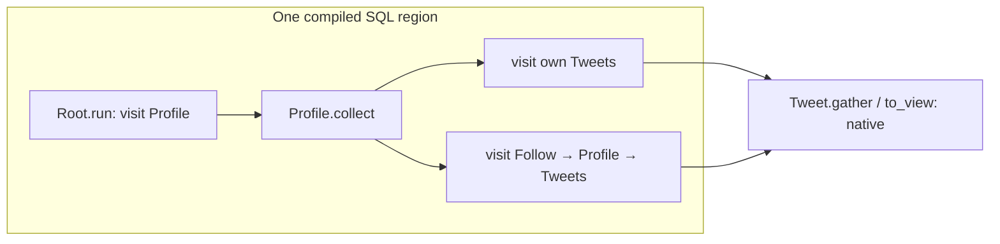

# LittleX: one SQL region across abilities

The repair composes `load_feed`'s Root entry and Profile entry into one compiler-emitted SQL statement. The intermediate Profile IDs stay inside SQL; the client does not fetch them and then construct the next query. Both the profile's own Tweets and followed profiles' Tweets are included. `Tweet.gather` / `to_view()` remains a native execution boundary.

This is a finite pure-visit DAG compiler, not a LittleX-specific SQL string. Static visit-site identities and dispatch edges connect the abilities. SQL CTEs feed each parent path's target IDs into its children's origin relation. Repeated fetch origins may share cache; native FIFO activations, repeated visits and output order remain unchanged. The compiler stops the next whole layer when an entry is opaque or has state effects. Cyclic expansion falls back to the existing implementation.

The same statement returns a complete persisted type catalog for the authenticated ACL proof. Unknown or custom access implementations, changed dispatch, overflow or incomplete paths reject publication. All native path-cache entries are validated before atomic publication. This catalog is metadata in the one statement, not another database round trip.

## Fresh small comparison

Eight fresh full LittleX workflows: one excluded warmup and three measured workflows per version. Both versions use the same original smoke fixture and native workflow, Always/process with one worker, limit 2048, uniform pre-workflow ANALYZE, WAL settings and instrumentation. Baseline is `addd3a4`; after is the exact tested source subsequently committed as `5ce63eacd`. No historical timings are reused.

| Metric | Before | After |
|---|---:|---:|
| Path SQL per `load_feed` | 2 | 1 |
| All SQL per `load_feed`, including controls | 15 | 14 |
| All SQL per primary workflow | 147 | 143 |
| DB protocol interval sum, median | 56.337 ms | 55.085 ms |
| Sum of 9 primary HTTP response intervals, median | 1582.225 ms | 1483.832 ms |
| Sum of 4 `load_feed` HTTP response intervals, median | 1048.723 ms | 982.568 ms |

All counts are identical across each version's three measured repetitions. DB sum equals interval union in these captures. HTTP response-sum ranges are 1568.326–1585.306 ms before and 1469.981–1489.082 ms after. The observed median response-sum reduction is 6.2%; this is a small instrumented comparison, not a general speedup estimate.

The remaining 143 SQL calls include payload loads, other business operations and controls. Background process creation and teardown are unchanged. This repair reduces path round trips; it does not eliminate the process startup cost identified in the previous study. No CPU time or IPC duration is inferred by subtracting DB time from HTTP time. Cost-model changes, persistent worker reuse and larger datasets are outside this repair.

## Validation and evidence

- 25 focused static/native tests passed: pure DAG compilation, multiple origins, empty paths, duplicate Tweet visits, native output order, authenticated visibility, custom descendant ACL rejection, overflow and cache consumers with zero additional SQL. Changed sources were typechecked and formatted.
- All eight workflows passed the existing independent full-response, restart, graph/physical-state and owned cleanup gates. Their fixture/action/output digests agree. Each uses a unique database; all eight were dropped only after successful validation and zero active sessions.
- The separate raw audit rehashed 496 sealed files, recomputed SQL counts and send-to-Ready intervals, verified actual background child/backend identity, and joined every feed's query and region counters. Each repaired feed has one region query, three published path caches, one reuse and no region fallback.
- Controller exited zero; owned PostgreSQL stopped naturally with no retained databases. No large dataset was run.

Paths relative to `/home/baichuan/jaseci`:

- Final source/test proof: `project-notes/measurements/ttg-littlex-region-repair-20261102/verification-inline.json`
- Exact native logs and source-before/after: `project-notes/measurements/ttg-littlex-region-repair-20261102/native-final-v2/`
- Final comparison, vectors and raw references: `project-notes/measurements/ttg-interability-performance-20261101/littlex-dag-repair-v4/results.json`
- Actual emitted statement: `project-notes/measurements/ttg-interability-performance-20261101/littlex-dag-repair-v4/actual-cross-ability.sql`
- Reproducible comparison and independent raw arithmetic: `reproduction/ttg-littlex-region-repair/compare_v4.py` and `analyze.py`

Earlier failed or superseded attempts remain intact. In particular, v2 used a separate catalog proof query: it reduced path queries but did not reduce feed SQL totals. The final inline-catalog version above is a new fresh capture; v2 is not counted in its results.
