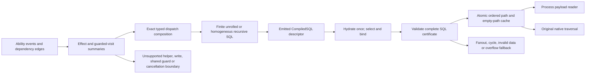

# Static interability SQL regions

Owner: runtime/compiler/SQL and focused tests in `jac-ttg`, branch `feat/ttg-interability-regions`, baseline `9282e246d708aff69e21cb52b9d0cc4893fc5f0f`. Work started 2026-11-01. Old published sources and performance harnesses remain frozen.

## Minimal contract (design v1)

The compiler emits an effect summary for each entry ability: dispatch type, node-local scalar reads, shared access reads/writes, output-only writes, visit sites and guards, and first unsupported effect. A region composes exact typed visit dispatch edges between those summaries. It never derives a chain from a visited counter. Output-only scalar reductions/list appends can be certified separately from accesses; shared state read by access guards, graph writes, cancellation, unknown calls and ambiguous dispatch exclude that ability from the first supported kernel.

First executable scope: one typed outgoing visit per eligible ability, possibly guarded by a node-local ordinary scalar predicate, with only output operations otherwise. A self edge gives a recursive homogeneous region; A→B→C gives a finite composed region. Last unresolved external effect is a boundary: the target may be fetched, but its ability is not expanded. Pure helper predicates get an explicit summary or remain unsupported; calls are never assumed pure.

SQL is constructed during checkpoint compilation and serialized as CompiledSQL descriptors with fixed parameters plus origin, actor, runtime type/module and row-budget slots. Runtime validates exact classes/handlers/field access, selects and binds the emitted descriptor, and executes no SQL AST construction on that path. Native per-origin ordered pairs and empty markers are published atomically only after complete validation. Existing process payload dispatch is reused; native handlers, FIFO queue, outputs and disengage execute unchanged.

A recursive SQL region must prove actual cardinality at each step, reject fanout and repeated identities/cycles, and detect truncation before publication. The row cap is a resource limit, not native traversal depth or a semantic cutoff. Invalid/missing scalar fields, subtype/custom dispatch, unsupported effects, ACL uncertainty, pending interference, fanout, cycle or overflow cause conservative fallback with no partial region cache. Native typed cache keys retain full-hop/prefix distinctions.

Planned API: `compile_interability_regions(arch, graph)` returns versioned `summaries`, `regions`, `rejections` and `templates`; `resolve_interability_region(...)` validates and binds one static region. Stable region/event IDs prevent reopening completed work. Region selection precedes the old continuation interpreter; existing interpreter/template fallback is explicitly labelled separately.

Focused fixtures: a new no-counter typed Traverse, a guarded typed A→B→C, and negative shared-state, write, cancellation, unknown helper/dispatch, fanout, cycle, null/invalid field, overflow and authenticated cache-consumption cases. Correctness and actual activation must pass before a clean commit is released. No performance claim is made.

Stage 2 is conditional: independent LittleX prefixes may use per-region identity and already-published path reuse, not unconditional retries. Cost admission and DB prepared statements are outside this implementation scope.

## Status

Source inspection and design completed; implementation in progress. DB window unclaimed by other workers; no DB or tests started yet. Available storage observed: 1,131,188,224 bytes. One small owned cluster with WAL 32/64 MiB will be used; no full runtime copies.

## Implementation checkpoint (in progress)

The new `ttg_regions.jac` compiler pass emits per-ability summaries, fixed typed dispatch edges, Boolean guard IR, and entry dependency certificates. Finite compositions use unrolled CTEs; recursive lowering is reserved for a single homogeneous self-transition. Ordinary `B.active: bool` is the first predicate kernel. JSON type validity is returned explicitly; false is distinct from malformed/missing/null. `json_kind` is a small typed AST function without casts.

API remains `dependency_prefetch(..., fused_sql=True, mode="process", workers=1, max_length=2048)`. New scalar fusion counters are `region_queries`, `region_cache_paths`, `region_origins`, `region_reuses`, `region_fallbacks`, `region_fallback_reason`, and `effective_region_mode`. Emitted artifact `interability_regions` contains summaries, regions, templates, dispatch provenance, external dependencies, SQL-internal fields and rejection reasons. Unknown helpers remain boundaries; shared thresholds are rejected rather than described as supported last-dependency placement.

The first DB-free run failed on two fixture/test typing issues (a keyword parameter and an intentional wrong SQL argument lacking an `any` cast). The compiler bootstrap completed; a corrected run is in progress. No native result is claimed yet.

## Reviewer repair checkpoint

Source-v1 review identified concrete descriptor/write, node-exit trigger, submission-cap, unsafe output arithmetic and internal metadata activation gaps. Source-v2 fixes these with bounded checks. The initial arithmetic kernel supports total integer expressions over exact walker integer values and constants (`+`, `-`, `*`); node-operand arithmetic and division/modulo are explicit unsupported boundaries. Output-only counter increments and direct scalar reports remain eligible. This is a narrower proof, not a claim that all reductions influence access.

The existing entry observer already invokes prefetch before the ability body; its compiler emitter was restored unchanged instead of adding a duplicate entry hook. Native activation is still pending. No performance release exists.

## Tested source release and quiet handoff

Final core commit: `addd3a4fb08819699d88afcf9a4ef8f1744d1ae4`, clean on `feat/ttg-interability-regions`. The owner committed only the ten runtime/SQL/test files; main owns pushing. Final selected regression: **220 passed in 19.05 s**, with all ten source hashes unchanged across the run. The earlier focused native suite passed nine tests. The machine-readable release proof is `measurements/ttg-interability-20261101/verification.json` (SHA-256 `1db5b36aaf53b6b1107a31d294a0774f8efb1cbe56e649ec79fb83125faecb73`).

Native evidence demonstrates one static query for an eight-node no-counter chain, eight ordered cached paths including the real terminal empty path, and seven covered-entry reuses. A Boolean A→B→C region uses one composed query: true publishes two paths; false publishes only the A→B path, with no fabricated B→C empty cache. Strict native traversal records actual `_sql_pairs` calls with zero parent `store.rows` calls and forbids native SQL reconstruction. Authenticated direct consumption also forbids runtime SQL AST/rendering. Fanout, cycles, overflow, malformed guard storage, output descriptors, node exits and remaining payload limits have focused checks.

Stage 2 demonstrates an untyped root followed by two independent collect paths: exactly two emitted-template queries total, no fallback resolver calls, one native-cache reuse, and unchanged duplicate output `[31,31]`. Additional attempts are limited to compiler-marked pure visit prefixes; existing collector barriers remain in force.

One historical thread-mode promotion test failed in the first selected regression, before its later output assertion. The same-source isolated case passed. The historical cause remains unresolved and consistent with the permitted foreground deadline path. The existing completed-cache test now joins its real dispatched workers before demand; all original assertions remain, production Session/timeout/accounting are unchanged, and the existing worker-failure foreground fallback case remains unchanged.

The stopped regression cluster was preserved losslessly in `stopped-regression-archive-v1/regression-pg-main.tar.gz` (SHA-256 `8186c9de3452f2bf4dbd4d5764075d798fc015315828ff98ff22acbb91187a4b`, 111,890,644 bytes). All 30,596 members passed SHA readback before the uncompressed owned directory was reclaimed. Failed fixture databases, member inventory and exact restore mapping are retained. Regenerable JIR cache reclamation is separately recorded. Final lifecycle proof reports zero owned live jobs and the remaining small native cluster stopped. No performance measurement has been made by this implementation lane.

P7 owns the next snapshot/bootstrap and fifteen application correctness cases under main authorization. Core source is frozen; this lane performs only light explanation work during that window.

## Method explanation and diagram inputs

Source-bound inputs: `measurements/ttg-interability-20261101/method-inputs-v1.json`. The actual guarded SQL is copied from accepted native evidence to `method-guard-actual.sql`; it was not regenerated. The following is an explanation diagram, not an additional execution record.

The summary separates output writes from accesses. Its `shared_access_reads` field is a conservative walker-wide union used to reject writes that feed recorded access branches; this is not a general precise helper/heap/alias analysis. Supported predicates are node-local Boolean expressions. The entry checkpoint follows origin/context binding, while predicate data remains inside SQL. External thresholds assigned by earlier abilities are rejected; general last-external-dependency placement is future work.

The runtime validates actual single-successor cardinality and repeated identities before publication. A visited count remains total activations, never a depth proof. The query row/depth cap is a resource boundary that triggers fallback without changing native termination semantics. Original FIFO execution, duplicate visits, outputs and disengage remain native.

## Existing admission model and roadmap

Exact `AlwaysPrefetch` currently enables fusion. The existing optional `ExpectedBenefit` model uses measured demand probability, payload cost, available overlap and resolution cost; after sufficient samples its score is `p * min(payload, overlap) - resolution_cost - (1-p) * payload * unused_weight - margin`. Resolution cost applies at the resolve phase. Default minimum samples are three; cold probing and periodic probes remain existing behavior. This implementation does not redesign that model. Shared fused-batch feedback is marked diagnostic and excluded from per-plan training.

Future work includes broader helper/alias/heap summaries, dominated external guard bindings and region-level cost admission. Server-side prepared-plan reuse was not added or evaluated. General graph FIFO interpretation, source rewriting to remove dependencies, and a universal proof of sibling independence are outside the implemented kernel.
