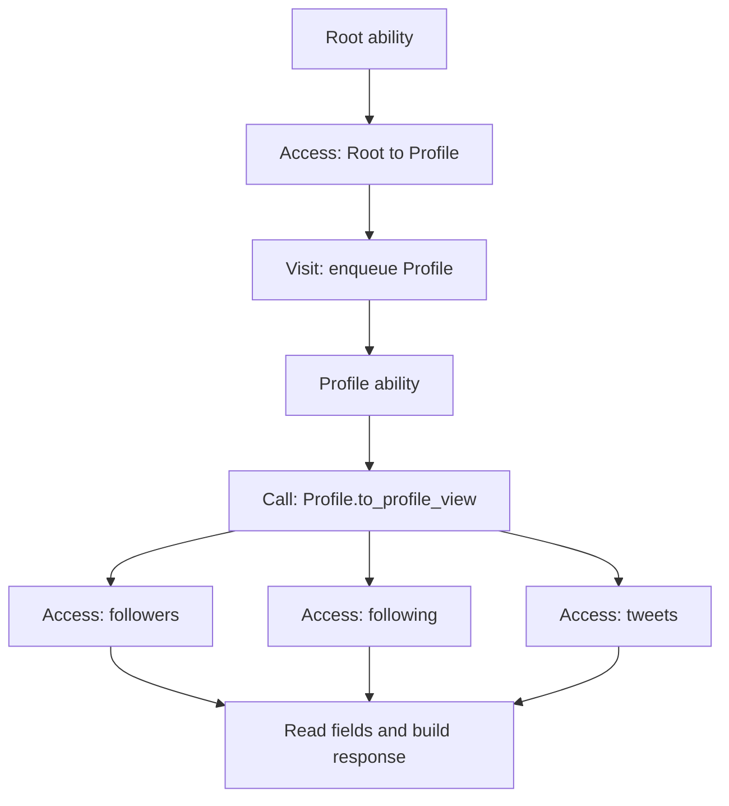

# Access demands and Visit scheduling

This implementation separates graph-query payload demands from walker scheduling. A graph expression is an Access; Visit consumes its result to enqueue nodes and select subsequent abilities. Ordinary method reads can therefore be prefetched without inventing visits.

## Execution

`ttg_access_graph.py` exports an opt-in, source-located analysis graph with separate value, data and control dependencies. No local Visit flow is not automatically a global non-visit proof.

`ttg_access_plan.py` compiles an executable Access-demand projection into each checkpoint artifact. Descriptors carry the graph origin, typed hops, constant property predicates, guards, call provenance and singleton-prefix obligations. Local methods are selected using the receiver's declared node type; local function arguments are bound explicitly. It does not guess a method solely by its name.

The existing Visit continuation and compiled-region executors remain the scheduling projection. Their inline graph-query accesses are identified as `visit_projection`; ordinary Access descriptors use the new entry executor. The new executor does not modify native queues, synthesize ability dispatch or execute user methods while planning. It reuses the existing path resolver/ACL checks, cache epochs, remaining payload budget, model admission and thread dispatch. Duplicate and already covered payload IDs are excluded. Standard-access runtime restrictions remain unchanged.

The current executable slice admits here/root-based paths, resolved ordinary calls and composed comprehension paths. Unknown methods/effects stop the admitted prefix. Branch continuations, loop-carried state, callee guards and general heap aliases remain boundaries. Projection of an indexed prefix into a subsequent path requires a runtime singleton check. This is not a complete arbitrary-program interprocedural optimizer, nor a new recursive SQL compiler.

Currently the additional ordinary-Access path is enabled under the same exact AlwaysPrefetch + fused-SQL configuration as the existing conservative compiled regions. Other cost-model modes are unchanged. Access counters are diagnostic; new demand sites are not trained into another cost model.

## Validation

- 15 Access/Visit graph checks over parsed Jac source.
- 13 executable demand/guard/call-binding checks over parsed Jac source.
- Native group 1: 26 passed, including Access-only methods, false guards, property predicates, payload limits and unchanged Visit behavior.
- Native group 2: 40 existing region/template/frontier/ACL tests passed.
- Both owned native runs stopped PostgreSQL; exact source-start/end and output records are retained under `measurements/ttg-access-visit-20261110/native-v1` and `native-v2`.
- The first preliminary dependency test invocation passed 14 checks, then failed to start a sandbox-denied default PostgreSQL socket. Its log is retained; the successful groups ran on a separate owned loopback cluster.

The three-app comparison uses the exact prior fixed JDrive small and LittleX small scenarios and the accepted RecipePantry scenario (including the two extra read-only ShoppingList states). Both modes share one new frozen runtime; aggressive policy execution remains unchanged. There are 24 fresh workflows: 6 excluded warmups and 18 measured (n=3 per app/policy). Every case retains native response/state/restart/session/physical checks, GIL-off assertions and owned cleanup proof. Results are precision-instrumented, not an uninstrumented latency benchmark.

## Metrics

Prefetch usefulness is the fraction of distinct returned payload IDs subsequently used by foreground code. Demand coverage is the fraction of distinct foreground-demand IDs served by prefetch. Both are request/session-local and summed over each fixed workflow. Also report absolute unused objects, repeated/late deliveries, actual Visit coverage, and SQL data/control counts. Do not call useful Access-only prefetch wasted merely because no Visit occurs. Demand denominators can change when SQL filtering avoids materializing candidates.

Existing publication packages, previous result files and the aggressive worktree are unchanged. The development implementation is in the existing `jac-ttg` workspace.

## Completed app validation

All 24 fresh workflows passed (6 excluded warmups, 18 measured; three repeats per app/policy), with unchanged business outputs between policies. Actual thread execution asserts GIL disabled. The raw precision audit rehashed 1,920 sealed files. All owned services and PostgreSQL stopped, with 24 validated successful database drops and no retained failed databases. Native test source-start/end maps match in both successful groups.

Counts below are request/session-local unique payload IDs summed over the fixed workflow. All three measured repeats have identical counts.

| App | Policy | Prefetched | Subsequently used | Unused | Demand coverage | Data SQL | Control SQL |
|---|---|---:|---:|---:|---:|---:|---:|
| JDrive | Aggressive | 1090 | 319 | 771 | 91.40% | 208 | 52 |
| JDrive | Conservative + Access | 265 | 265 | 0 | 92.01% | 53 | 54 |
| LittleX | Aggressive | 357 | 357 | 0 | 92.97% | 74 | 70 |
| LittleX | Conservative + Access | 357 | 357 | 0 | 92.97% | 73 | 71 |
| RecipePantry | Aggressive | 112 | 112 | 0 | 67.07% | 189 | 150 |
| RecipePantry | Conservative + Access | 51 | 51 | 0 | 31.10% | 207 | 144 |

Compared with the earlier same-workflow precision captures, useful Conservative prefetch increased from 258 to 265 for JDrive, 287 to 357 for LittleX, and 31 to 51 for RecipePantry. These are count comparisons, not cross-run latency comparisons. JDrive and RecipePantry have different actual-demand denominators between policies because filtering avoids some candidate materialization.

LittleX closes the identified ordinary-Access gap: `get_profile` now prefetches 70 used objects (previously 1), and `follow_user` prefetches its one used profile (previously 0). All 27 paired measured requests have equal fixed-fixture logical prefetch-ID sets between policies. The last feed additionally contains one freshly created node in each mode; their UUIDs differ, and only their count and accepted business semantics are compared. Of the 357 prefetched objects, 287 are entered by the walker and 70 are used without entry. Those 70 are useful Access demands.

JDrive's two `ListFolder` requests now prefetch 3 and 4 used objects without visits; tree pruning remains effective. RecipePantry's all-planned and mixed-state `ShoppingList` calls now prefetch 9 and 5 used objects; the all-cooked call prefetches none. Its coverage remains partial: the static executable plan stops at `jobj` in `CookMeal`/`BuyIngredient`, unresolved output methods, and unsupported control/effect summaries. No claim of full demand coverage is made. The plan-only source evidence is saved as `recipe-access-plan.json`.

This implementation resolves additional ordinary Access paths through the existing SQL resolver; it does not yet fuse all of those paths into one SQL statement. The count results establish improved useful prefetch coverage, not a latency speedup. Empty-loop control, arbitrary helper effects and general aliases still need stronger executable summaries; this is not a universal zero-overfetch guarantee.

Reproducible raw audit, CSV, final derived binding and host-stop proof are in [the comparison evidence directory](measurements/ttg-access-visit-performance-20261110). `analyze.py` produces `results.json`/`table.csv`; `finalize.py` binds the successful native runs, app results and paired LittleX logical-ID checks into `final-binding.json`.
